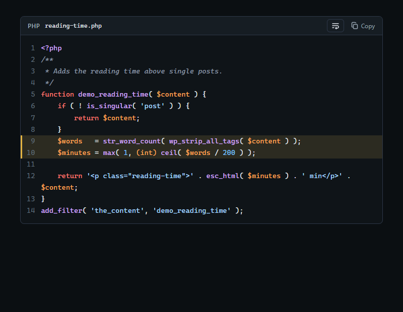

# Code Beautifier Block

A WordPress block for code that stays inside the layout. Highlighting happens on the server, long lines wrap or scroll inside the block, and unbroken strings such as URLs, hashes or base64 never push the page sideways.

- Server-side syntax highlighting for 20 languages, plus automatic detection
- Never wider than the content column, also in flex and grid layouts (`contain: inline-size`)
- Wrap mode breaks long strings at any character; readers can switch to horizontal scrolling per block
- Copy button (line numbers are never copied), optional file name, start number and highlighted lines
- Light and dark colours that follow the system setting or a `data-theme` attribute; every colour is a CSS custom property
- Readable fallback: the post content keeps a plain `<pre><code>` copy of the code
- Transforms from the Code, Preformatted and Code Block Pro blocks
- No options, no cookies, no external requests

Requires WordPress 6.5 and PHP 7.4. Details in [readme.txt](readme.txt).

## License

GPL-2.0-or-later, see [LICENSE](LICENSE).
